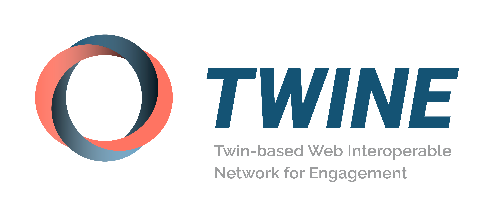

# TWINE – Visual Identity

Brand guidelines, logo files and presentation template for **TWINE** (*Twin-based Web Interoperable Network for Engagement*).

**[Preview and download the logos →](https://twine-project.github.io/visual-identity/)** · **[Download everything (.zip) →](https://github.com/twine-project/visual-identity/releases/latest)**



## About TWINE

TWINE is a Horizon Europe research and innovation action on Web 4.0 and Virtual Worlds. It demonstrates how open, federated and human-centric infrastructures can make digital twins and immersive civic services interoperable, accessible and trusted for citizens, cities and SMEs, with pilots in Rotterdam, Tampere and Flanders.

| | |
| --- | --- |
| Grant agreement | 101298722 |
| Call / topic | HORIZON-CL4-2025-03 / HORIZON-CL4-2025-03-HUMAN-16 |
| Type of action | Research and Innovation Action (RIA) |
| Duration | 36 months |
| Coordinator | imec (Interuniversitair Micro-Electronica Centrum), Belgium |
| Website | [twine-project.eu](https://twine-project.eu/) |
| LinkedIn | [twine-eu](https://www.linkedin.com/company/twine-eu/) |
| YouTube | [@twine-project-eu](https://www.youtube.com/@twine-project-eu) |
| Zenodo | [twine-project-eu community](https://zenodo.org/communities/twine-project-eu/) |
| Contact | [info@twine-project.eu](mailto:info@twine-project.eu) |

### Consortium

| Partner | Country |
| --- | --- |
| imec – Interuniversitair Micro-Electronica Centrum (coordinator) | BE |
| OASC – Open & Agile Smart Cities | BE |
| Engineering – Ingegneria Informatica SpA | IT |
| The Lisbon Council for Economic Competitiveness | BE |
| Gemeente Rotterdam | NL |
| Tampereen Kaupunki (City of Tampere) | FI |
| Suomen Itämeri-Instituutin Säätiö (affiliated entity of the City of Tampere) | FI |
| Vlaamse Gewest (Flemish Region) | BE |
| Future Insight Group BV | NL |
| Business Tampere Oy | FI |

## Repository structure

```
├── guidelines/
│   ├── twine-brand-guidelines-2026.pdf   Brand guidelines – the reference for every rule below
│   └── twine-logo-sheet.pdf              Overview sheet of all logo versions
├── logos/
│   ├── svg/{horizontal,vertical,logomark}/   Vector – web and digital use
│   ├── png/{horizontal,vertical,logomark}/   High-resolution raster, transparent background
│   └── eps/twine-logo-sheet-cmyk.eps         Vector, CMYK – print
├── templates/
│   └── twine-presentation-template-v0.4.potx PowerPoint template
├── index.html                            Preview page (GitHub Pages)
├── CHANGELOG.md
└── LICENSE
```

Logo files follow the pattern `twine-<layout>-<variant>.<ext>`, for example `logos/svg/vertical/twine-vertical-white-lines.svg`.

## Brand guidelines

The [brand guidelines](guidelines/twine-brand-guidelines-2026.pdf) (13 pages, 2026) were designed by Manuela Fiori (visual strategy, design & multimedia production). They cover:

1. **Concept** – *Human-Centricity Intersection*, rooted in "Community and Immersive Services". Minimal geometric shapes intersect and overlap to symbolise the touchpoints between Web 4.0 and the federation members.
2. **Mood board** – keywords: *intertwine, connect, trust, infrastructures, interoperable, collaborate, intersect, stripe*.
3. **Colour palette** and swatch information (HEX, RGB, HSB, CMYK).
4. **Colour combinations** with accessible contrast pairings.
5. **Typography**.
6. **Logomark**, **logotype** and **tagline**.
7. **Logo lockup**, **spacing** and **monochrome variants**.

### Colour palette

| Colour | HEX | RGB | CMYK | Role |
| --- | --- | --- | --- | --- |
| Slate Blue | `#285271` | 40, 82, 113 | 93, 58, 35, 17 | Main – trust and EU institutional stability |
| Red Orange | `#DF2E10` | 223, 46, 16 | 0, 96, 100, 0 | Main – dynamism |
| Melon Orange | `#F47D69` | 244, 125, 105 | 0, 65, 51, 0 | Main – energy, warmth and togetherness |
| Industrial Silver | `#AAADB0` | 170, 173, 176 | 39, 27, 26, 0 | Main – technology and balance for supporting assets |
| Steel Blue | `#487A9F` | 72, 122, 159 | 83, 40, 22, 2 | Secondary |
| Air Blue | `#75A0C0` | 117, 160, 192 | 63, 23, 15, 0 | Secondary |
| Light Steel Blue | `#AAC5D8` | 170, 197, 216 | 40, 12, 10, 0 | Secondary |
| Pastel Peach | `#F8B0A3` | 248, 176, 163 | 0, 42, 28, 0 | Secondary |
| Sonic Silver | `#71757A` | 113, 117, 122 | 62, 45, 42, 12 | Neutral |
| Guide Ink | `#2C2C31` | 44, 44, 49 | 80, 62, 54, 58 | Neutral (dark text) |
| Black | `#000000` | 0, 0, 0 | 95, 82, 82, 90 | Neutral |
| White | `#FFFFFF` | 255, 255, 255 | 0, 0, 0, 0 | Neutral |

### Typography

| Font | Use |
| --- | --- |
| [Raleway](https://fonts.google.com/specimen/Raleway) Bold | Titles, headers, subheaders |
| [Albert Sans](https://fonts.google.com/specimen/Albert+Sans) Regular | Paragraphs, quotations |

Both fonts are free on Google Fonts.

## Logo

The logo is made up of three elements:

- **Logomark** – three interlaced rings, built from overlapping circles, in Slate Blue, Melon Orange and Air Blue.
- **Logotype** – the word *TWINE* in bold italic capitals.
- **Tagline** – *Twin-based Web Interoperable Network for Engagement*, in grey.

### Layouts

- **Horizontal** – logomark to the left of the logotype and tagline. The preferred version for most uses.
- **Vertical** – logomark above the logotype and tagline. Use where horizontal space is limited.
- **Logomark** – the symbol on its own. Use for avatars, favicons and small spaces.

### Colour variants

| Variant | Description | Background | Horizontal | Vertical | Logomark |
| --- | --- | --- | :---: | :---: | :---: |
| `main` | Full-colour logomark with gradients, Slate Blue logotype, grey tagline | Light | SVG · PNG | SVG · PNG | SVG · PNG |
| `main-white-tagline` | Full-colour logo with a white tagline | Mid-tone or coloured (the logotype stays Slate Blue) | SVG · PNG | SVG · PNG | – |
| `black-gradient` | Monochrome positive, greyscale with gradients | Light | SVG · PNG | SVG · PNG | SVG · PNG |
| `white-gradient` | Negative, white typography | Dark | SVG · PNG | SVG · PNG | – |
| `black-lines` | Flat black line version, no gradients | Light, single-colour printing | SVG · PNG | PNG | SVG · PNG |
| `white-lines` | Flat white line version, no gradients | Dark, single-colour printing | SVG · PNG | SVG · PNG | SVG · PNG |

The EPS file contains all versions on a single CMYK artboard for print.

### Clear space

The minimum clear space around the lockup is based on a reference unit taken from the letter **E** of the logotype. The same unit separates the logomark from the logotype and the logotype from the tagline. See page 09 of the guidelines.

### Usage

- Prefer **SVG** for digital use and **EPS** for print; use **PNG** only where vector files are not supported.
- Do not stretch, distort, recolour or rotate the logo.
- Use the negative (white) versions on dark or photographic backgrounds to ensure legibility.
- Do not separate the tagline from the logotype, unless you are using the logomark on its own.

## Presentation template

[`templates/twine-presentation-template-v0.4.potx`](templates/twine-presentation-template-v0.4.potx) is a 16:9 PowerPoint template using the brand fonts (Raleway SemiBold for headings, Albert Sans for body text). It includes these slide layouts:

- Cover – Blue
- Cover – Red Orange
- WP Opening
- Section Divider
- Title and Content
- Two Content
- Title Only
- Content with Picture
- Split Panel
- Key Message
- Task Update
- Closing
- Blank

Open the `.potx` file to create a new presentation from it. Install Raleway and Albert Sans first so the slides display correctly.

## Releases

Each [release](https://github.com/twine-project/visual-identity/releases) includes a `.zip` with all the files in this repository. Changes are listed in the [changelog](CHANGELOG.md).

## Licence

Copyright © 2026 TWINE Consortium. All rights reserved.

The TWINE name and logo are not released under an open-source or Creative Commons licence. They may be used, unmodified, only to refer to the TWINE project and in line with the brand guidelines. See [LICENSE](LICENSE) for details.

## Funding

Funded by the European Union under grant agreement No 101298722. Views and opinions expressed are however those of the author(s) only and do not necessarily reflect those of the European Union or the granting authority. Neither the European Union nor the granting authority can be held responsible for them.
